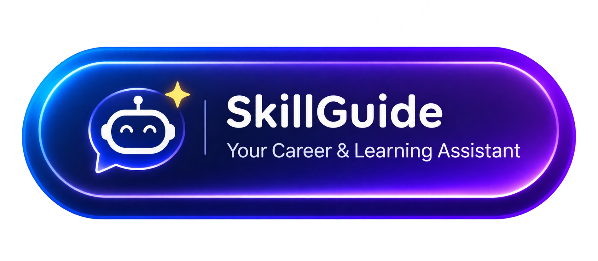
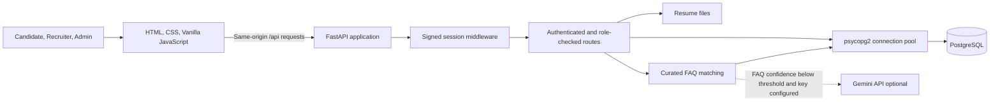
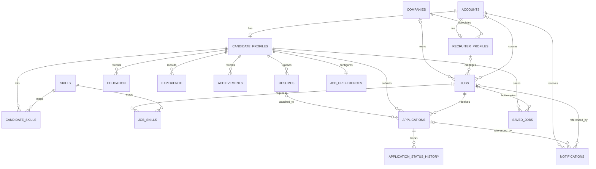

<div align="center">
  
  <h1>SkillBridge</h1>
  <p><strong>Find opportunities that fit your skills, interests, and goals.</strong></p>
  <p>A student career platform for discovering jobs, internships, hackathons, and other curated opportunities.</p>
  <p>
    
    
    
    
    
  </p>
</div>

<p align="center">
  <a href="#overview">Overview</a> ·
  <a href="#features">Features</a> ·
  <a href="#architecture">Architecture</a> ·
  <a href="#local-setup">Setup</a> ·
  <a href="#api-reference">API</a> ·
  <a href="#deployment">Deployment</a>
</p>

---

## Overview

Students often have to search across separate sites to find opportunities that match their skills and eligibility. SkillBridge brings discovery, skill-aware recommendations, saved listings, and application tracking together in one place.

The platform supports three roles:

| Role | What they do |
| --- | --- |
| **Candidate** | Build a profile, add skills and preferences, discover opportunities, save listings, and track supported applications. |
| **Recruiter** | Manage company opportunities and review applicants for their organization. |
| **Platform Administrator** | Review organizations and recruiter links, curate opportunities, and manage platform-level records. |

Opportunity publishing currently belongs to recruiters and platform administrators. Separate college, event-organizer, or other provider accounts are not part of the current role model.

## Features

<table>
  <tr>
    <td width="50%"><strong>Discover</strong><br />Search and filter jobs and internships. Browse a dedicated hackathon view with organizer, location, eligibility, and event details when supplied.</td>
    <td width="50%"><strong>Match</strong><br />See recommendations based on candidate skills, preferences, branches, and opportunity eligibility data.</td>
  </tr>
  <tr>
    <td><strong>Track</strong><br />Save opportunities, submit supported applications, review application status/history, and withdraw when the workflow allows it.</td>
    <td><strong>Build a profile</strong><br />Maintain skills, education, experience, preferences, and achievements; upload and manage CVs.</td>
  </tr>
  <tr>
    <td><strong>Recruit</strong><br />Create and manage company opportunities, review applicants, and update application stages.</td>
    <td><strong>Administer</strong><br />Review recruiter-company relationships, manage curated opportunities, and inspect platform records.</td>
  </tr>
  <tr>
    <td><strong>Stay informed</strong><br />Use in-app notifications and candidate, recruiter, and admin analytics views.</td>
    <td><strong>Ask SkillGuide</strong><br />Get answers from the curated FAQ knowledge base, with optional Gemini fallback for questions without a strong FAQ match.</td>
  </tr>
</table>

Listings are not a live feed from every external provider. Administrator-curated opportunities are stored in the SkillBridge database, and external applications or registrations use the source link where configured. Check the official source for current availability and requirements.

## Screenshots

The repository currently contains the SkillGuide brand logo, but no screenshots of the running product. Add genuine captures to `docs/screenshots/` when available:

| View | Screenshot to add |
| --- | --- |
| Candidate dashboard | `docs/screenshots/candidate-dashboard.png` |
| Browse jobs | `docs/screenshots/browse-jobs.png` |
| Browse hackathons | `docs/screenshots/browse-hackathons.png` |
| Platform admin | `docs/screenshots/admin-dashboard.png` |

No mock or generated product screenshots are included.

## Architecture

The FastAPI application serves the HTML, CSS, and JavaScript frontend and its `/api` endpoints from one origin. The browser sends the signed session cookie with API requests. Route handlers enforce authentication, role, and ownership checks before using PostgreSQL or resume storage.



Gemini is called by the backend only when FAQ matching is insufficient and `GEMINI_API_KEY` is configured. The frontend never receives the API key. Opportunity discovery and matching use stored SkillBridge listings; the Gemini fallback receives only the bounded question and is instructed not to claim live opportunity facts.

### Data model

The PostgreSQL schema uses foreign keys and junction tables for candidate/job skills, saved opportunities, and application history. The diagram shows the main relationships; the migration set adds further tables and opportunity metadata.



## Technology stack

| Layer | Technologies |
| --- | --- |
| Frontend | HTML5, CSS, vanilla JavaScript |
| Backend | Python 3.11, FastAPI, Uvicorn, compatibility helpers for existing route handlers |
| Database | PostgreSQL, `psycopg2` threaded connection pool, SQL schema and migrations |
| Authentication | Signed browser sessions using `itsdangerous`; Werkzeug password hashing; role-based authorization |
| Resume handling | `python-multipart`, `pypdf`, server-side file validation and storage |
| AI | Google Gemini via `google-genai` (optional server-side fallback) |
| Deployment | Render Blueprint in `render.yaml` |

The frontend is served by FastAPI; it does not have a separate Node build step.

## Project structure

```text
.
├── backend/
│   ├── routes/                  # Auth, candidate, recruiter, jobs, admin, analytics, notifications, chatbot
│   ├── __init__.py              # App factory, middleware, health checks, frontend serving
│   ├── config.py                # Environment loading and validation
│   ├── db.py                    # PostgreSQL connection pool
│   ├── session_middleware.py    # Signed session cookie
│   ├── gemini_service.py        # Optional Gemini provider
│   └── bootstrap_admin.py       # Explicit admin provisioning
├── database/
│   ├── migrations/              # PostgreSQL migrations 001–011
│   ├── schema.sql               # Base schema for a fresh database
│   ├── seed*.sql                # Explicit local/demo or dated catalog imports
│   └── import_admin_opportunities.py
├── frontend/
│   ├── index.html
│   ├── app.js
│   ├── styles.css
│   └── skillguide-logo-transparent.png
├── test_stage_*.py              # Existing stage-focused tests
├── .env.example                 # Placeholder configuration only
├── .gitignore
├── render.yaml
├── requirements.txt
├── setup_db.py
└── README.md
```

Local `.env` files, virtual environments, caches, uploaded files, and database backups are excluded by `.gitignore`.

## How it works

1. A candidate registers or signs in and completes their profile, skills, education, and preferences.
2. The candidate browses jobs or hackathons. Search, eligibility, deadline, and publication rules are enforced by backend routes.
3. Skill Matches uses candidate profile data and stored opportunity data to recommend relevant listings.
4. Candidates can save opportunities and submit applications where SkillBridge supports an internal application. External events use the configured official registration link.
5. Recruiters manage their company's opportunities and applicant workflow. Platform administrators review organizations and curate opportunities in the shared catalog.
6. BridgeMate checks the curated FAQ first, then may call Gemini through the server when there is no reliable FAQ answer and a key is configured.

## Local setup

### Prerequisites

- Windows 10/11 with PowerShell
- Python 3.11
- PostgreSQL
- Git
- Optional: a Gemini API key for non-FAQ BridgeMate answers

### Install the application

```powershell
git clone <repository-url> SkillBridge
Set-Location .\SkillBridge
py -3.11 -m venv .venv
.\.venv\Scripts\Activate.ps1
python -m pip install --upgrade pip
python -m pip install -r requirements.txt
Copy-Item .env.example .env
```

Edit `.env` locally. Generate a strong session secret with:

```powershell
python -c "import secrets; print(secrets.token_urlsafe(48))"
```

Put the generated value in `SECRET_KEY`. Configure `DATABASE_URL` for the intended local PostgreSQL database. Reserved characters in the database username/password must be URL-encoded. Never copy a real secret into `.env.example` or commit `.env`.

### Initialize a fresh, empty database

`setup_db.py` creates the base schema and applies migration 001. It stops if it detects existing tables; only run it when the target is a new, empty database:

```powershell
python setup_db.py
```

Apply migrations 002 through 011 in numeric order after reviewing them. The project does not have a migration-history table or automatic migration runner. For an existing database, inspect the schema and apply only confirmed missing migrations; never use `setup_db.py` as an upgrade command.

Migration 009 changes publication status for a specific list of older curated listings and needs a review of its effects before applying. Migration 007 backfills `previous_status` where it can be inferred. No migration drops tables, truncates, or deletes rows, but row updates and constraint changes should still be reviewed against the target database.

Demo seeding is opt-in and only for a disposable local database:

```powershell
python setup_db.py --seed
```

This adds sample accounts and fictional listings. Never seed a production database or a database containing real records. The dated `database/seed_verified_hackathons_2026_11_22.sql` is a separate catalog import, not a migration; review its official sources and current event status before running it. `database/import_admin_opportunities.py` defaults to a dry run; inspect its output before using `--apply`.

### Provision a platform administrator

Admin accounts are not created through public registration. If the database has no platform administrator, set `ADMIN_USERNAME` and `ADMIN_PASSWORD` in `.env`, then run the explicit bootstrap command:

```powershell
python -m backend.bootstrap_admin
```

### Run the app

```powershell
python -m uvicorn backend.main:app --reload --host 127.0.0.1 --port 8000
```

Open <http://127.0.0.1:8000>. FastAPI's interactive API documentation is available at <http://127.0.0.1:8000/docs>. No separate frontend server or build command is required.

## Environment variables

Variable names and placeholder formats are in [.env.example](.env.example). Values below describe the current configuration; never publish actual values.

| Variable | Required | Purpose |
| --- | :---: | --- |
| `DATABASE_URL` | Yes | PostgreSQL connection URL |
| `SECRET_KEY` | Yes | Session-signing secret; at least 32 characters |
| `DEBUG` | No | Local development mode; use `0` in production |
| `PORT` | No | Local port; Render supplies `PORT` at runtime |
| `SESSION_COOKIE_SECURE` | No | Secure cookie flag; enabled by default when debug is off |
| `CORS_ORIGINS` | No | Exact comma-separated origins only if frontend/API use separate origins |
| `ADMIN_USERNAME` | No | Username for explicit admin bootstrap |
| `ADMIN_PASSWORD` | No | Password for explicit admin bootstrap |
| `GEMINI_API_KEY` | No | Server-side Gemini fallback key |
| `GEMINI_MODEL` | No | Gemini model override |
| `BRIDGEMATE_FAQ_MATCH_THRESHOLD` | No | FAQ match threshold from 60 to 100 |

## API reference

All endpoints are mounted under `/api`. Protected endpoints require the existing signed session and the appropriate role. These examples are verified against the route decorators; consult the handlers for request/response schemas.

<details>
<summary><strong>Authentication and health</strong></summary>

| Method | Path |
| --- | --- |
| GET | `/api/health` |
| GET | `/api/health/database` |
| POST | `/api/auth/register/user` |
| POST | `/api/auth/register/recruiter` |
| POST | `/api/auth/login` |
| POST | `/api/auth/logout` |
| GET | `/api/auth/me` |

</details>

<details>
<summary><strong>Candidate and opportunities</strong></summary>

| Method | Path |
| --- | --- |
| GET, PUT | `/api/candidate/profile` |
| GET, PUT | `/api/candidate/preferences` |
| GET, POST | `/api/candidate/saved-jobs` |
| DELETE | `/api/candidate/saved-jobs/{job_id}` |
| GET | `/api/candidate/recommendations` |
| GET | `/api/candidate/applications` |
| POST | `/api/candidate/applications/{app_id}/withdraw` |
| POST | `/api/candidate/resumes/upload` |
| POST | `/api/candidate/resumes/parse` |
| GET | `/api/jobs` |
| GET | `/api/jobs/hackathons` |
| GET | `/api/jobs/{job_id}` |
| POST | `/api/jobs/{job_id}/apply` |
| GET | `/api/skills` |

</details>

<details>
<summary><strong>Recruiter, administration, analytics, notifications, and BridgeMate</strong></summary>

| Area | Example methods and paths |
| --- | --- |
| Recruiter | `GET /api/recruiter/company`, `GET/POST /api/recruiter/jobs`, `PUT /api/recruiter/jobs/{job_id}`, `PATCH /api/recruiter/jobs/{job_id}/status`, `POST /api/recruiter/jobs/{job_id}/renew`, `GET /api/recruiter/applicants`, `PUT /api/recruiter/applications/{app_id}/status` |
| Admin | `GET /api/developer/stats`, `GET /api/developer/companies/pending`, `POST /api/developer/companies/{company_id}/review`, `GET/POST /api/developer/jobs`, `PUT /api/developer/jobs/{job_id}`, `PATCH /api/developer/jobs/{job_id}/status`, `GET /api/developer/applications` |
| Analytics | `GET /api/analytics/candidate`, `GET /api/analytics/recruiter`, `GET /api/analytics/admin` |
| Notifications | `GET /api/notifications`, `GET /api/notifications/unread-count`, `PUT /api/notifications/{notification_id}/read`, `PUT /api/notifications/read-all` |
| BridgeMate | `GET /api/chatbot/categories`, `GET /api/chatbot/questions`, `POST /api/chatbot/ask`; FAQ review routes are also available to authorized admins |

</details>

## Security and privacy

- Session and database secrets are read from environment configuration; `.env` is ignored by Git.
- Passwords are hashed with Werkzeug's PBKDF2-SHA256 helper. Browser sessions are signed and use `HttpOnly` and `SameSite=Lax`; the Secure flag is enabled for production configuration.
- Candidate, recruiter, and Platform Administrator routes enforce role checks. Recruiter applicant and opportunity operations are scoped to recruiter ownership in the backend.
- Resume uploads have file-type and size restrictions and are served only after an ownership check.
- Gemini runs server-side. The FAQ is checked first, and user text is treated as untrusted input; the model has no unrestricted SQL/database access.
- Keep `.env`, real user records, CVs, local database backups, and production credentials out of Git.

## Deployment

The project includes a Render Blueprint in [render.yaml](render.yaml), but the README does not claim that the app is deployed. It defines a Python Web Service with:

```text
Build:  pip install -r requirements.txt
Start:  python -m uvicorn backend.main:app --host 0.0.0.0 --port $PORT
Health: /api/health/database
```

Set `DATABASE_URL` to a production PostgreSQL connection and use a strong `SECRET_KEY`. The Blueprint sets `DEBUG=0`, enables secure session cookies, generates `SECRET_KEY`, and prompts for `DATABASE_URL`. `GEMINI_API_KEY` is optional. Render supplies `PORT`; the app serves the frontend and API on the same origin.

CVs are stored under `uploads/resumes/`. The Blueprint mounts a 1 GB persistent disk at `uploads/` so files survive service restarts. Render persistent disks require a paid service and attach to a single instance; move file storage to object storage before scaling horizontally. Automatic deploys are disabled in the Blueprint.

Before deployment, inspect the production database and apply only the reviewed missing migrations. The health check verifies database connectivity, not schema migration completeness. Do not run the initializer or demo seed against an existing production database.

## Contributing

1. Open an issue describing the bug or proposed change.
2. Create a focused branch and keep changes scoped to one improvement.
3. Check Python syntax with `python -m compileall -q backend` and frontend syntax with `node --check frontend/app.js`.
4. Run the relevant tests where the required Python and PostgreSQL environment is available. Do not use production data for tests.
5. Open a pull request with a summary, screenshots for UI changes, and test results.

## Planned improvements

These are future ideas, not currently implemented features:

- Migration tracking and a reviewed migration runner.
- Object storage for resumes before multi-instance scaling.
- Broader automated integration and browser end-to-end coverage.
- A future verified organization-provider model, while keeping the current three roles unchanged until approved.

## License

No license has been selected or included. The project is not currently offered under an open-source license; add a license only after the project owner chooses one.
